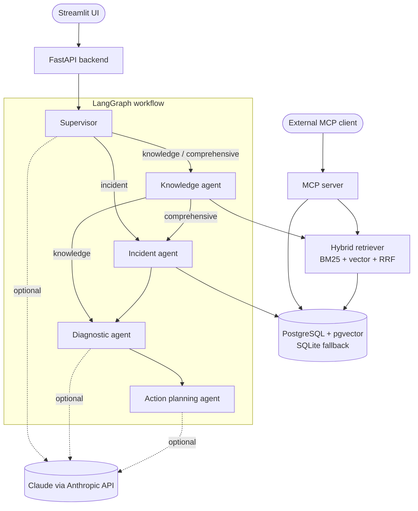

# ResolveAI — Multi-Agent Incident Intelligence & Troubleshooting Platform

[](https://github.com/HabibZouari/Multi-Agent-Incident-Intelligence/actions/workflows/ci.yml)
[](https://www.python.org/)
[](https://github.com/langchain-ai/langgraph)
[](https://fastapi.tiangolo.com/)
[](https://streamlit.io/)
[](LICENSE)

ResolveAI helps engineering teams investigate technical incidents. A **supervisor agent** classifies a question and
routes it through specialised agents that retrieve runbooks (hybrid BM25 + vector search), correlate historical
incidents, services and deployments, and produce grounded root-cause hypotheses and a step-by-step troubleshooting
plan. The same capabilities are exposed to external AI clients through a **Model Context Protocol (MCP) server**.

> **Works without an API key.** With no `ANTHROPIC_API_KEY` the supervisor falls back to a keyword router and the
> agents return an evidence summary, so the whole system (and the test-suite) runs offline. Add a key to switch the
> supervisor, diagnostic and planning agents to Claude.

## Features

- **Multi-agent orchestration (LangGraph)** – Supervisor → Knowledge / Incident agents → Diagnostic → Action planning. Each intent
  runs only the agents it needs (`knowledge`, `incident`, `comprehensive`) and every step is recorded in an execution trace.
- **Hybrid retrieval** – BM25 keyword ranking and vector similarity (pgvector on PostgreSQL, NumPy on the SQLite fallback)
  fused with Reciprocal Rank Fusion; section-aware chunking; cited sources; service filtering.
- **Grounding guard** – matches that are not anchored to a known service/failure mode are discarded, so the agents ask for
  details instead of presenting noise as evidence.
- **MCP server** – 7 typed tools (knowledge search, incident search/details/statistics, service dependencies, deployments,
  runbook-backed checklists) over stdio or streamable HTTP.
- **FastAPI backend** – investigation, incidents, services, deployments, hybrid search and validated document upload with
  immediate indexing.
- **Streamlit UI** – investigation chat, agent execution monitor, incident explorer, knowledge-base search/upload, evaluation dashboard.
- **Evaluation harness** – retrieval hit rate / precision / MRR, routing accuracy and workflow path adherence against a golden dataset.
- **Reproducible synthetic data** – 300 incidents, 20 services, 100 deployments, 50 runbooks and 50 golden questions generated with a fixed seed.

## Architecture



The built-in agents call the shared retrieval/data layer directly; the MCP server exposes that same layer to *external*
MCP clients (e.g. Claude Desktop). See [docs/ARCHITECTURE.md](docs/ARCHITECTURE.md) for design decisions and the data model.

## Quickstart

### Docker (PostgreSQL + pgvector)

```bash
cp .env.example .env        # then edit .env: set POSTGRES_PASSWORD (required), optionally ANTHROPIC_API_KEY
docker compose up --build
```

A one-shot `seed` service generates the dataset and seeds the database, then the services start:
UI <http://localhost:8501> · API docs <http://localhost:8000/docs> · MCP <http://localhost:8001/mcp>.

### Local (no Docker, SQLite fallback)

```bash
python -m venv .venv && source .venv/bin/activate      # Windows: .venv\Scripts\activate
pip install -r requirements-dev.txt
cp .env.example .env                                    # optional: leave DATABASE_URL unset to use local SQLite

python scripts/generate_dataset.py                      # synthetic incidents, services, runbooks, golden set
PYTHONPATH=. python scripts/init_db.py                  # seed the database (add --reset to rebuild)
PYTHONPATH=. uvicorn backend.api.main:app --port 8000   # API
streamlit run frontend/streamlit_app.py                 # UI (second terminal)
PYTHONPATH=. python mcp_server/server.py                # optional MCP server (stdio)
```

### Use the MCP server from Claude Desktop

```json
{
  "mcpServers": {
    "resolveai": {
      "command": "python",
      "args": ["mcp_server/server.py"],
      "env": { "PYTHONPATH": "." }
    }
  }
}
```

## Evaluation

```bash
PYTHONPATH=. python scripts/run_evaluation.py             # offline, deterministic, free
PYTHONPATH=. python scripts/run_evaluation.py --use-llm   # evaluate with the configured model
```

Latest offline run over the 50-question golden set ([`evaluation/results/latest_evaluation.json`](evaluation/results/latest_evaluation.json)):

| Metric | Result |
| --- | --- |
| Retrieval hit rate @3 (26 questions with ground-truth docs) | 96.2 % |
| Context precision @3 | 96.2 % |
| MRR | 0.962 |
| Routing accuracy (keyword router) | 100 % |
| Workflow completion / path adherence | 100 % / 100 % |

**Read these numbers with care.** The dataset is synthetic and template-generated, and the offline router was tuned against
those templates, so the scores show that the pipeline is wired correctly, not how it would perform on real incident data.
Evaluate on your own incidents and runbooks before drawing conclusions.

## Security & secrets

- **No credentials in the repository.** Secrets live in `.env` (git-ignored); only the placeholder `.env.example` is committed.
  `docker compose` refuses to start until you set `POSTGRES_PASSWORD`, and without `DATABASE_URL` the app uses a local SQLite file.
- **Optional API key.** Set `API_KEY` and every `/api/*` request must send it as `X-API-Key` (the Streamlit UI does this
  automatically). Leave it empty only for local development. `/health` stays open for health checks.
- Docker publishes all ports on `127.0.0.1` only. Put a reverse proxy with TLS in front before exposing the API.
- Uploads are restricted to `.md`/`.txt`, 1 MB, with sanitised file names; CORS is limited to `CORS_ORIGINS`.
- Never commit `.env`, real API keys or database dumps. If a secret was ever committed, rotate it: deleting the file does not remove it from git history.

## Testing

```bash
pytest          # 70+ hermetic tests: isolated SQLite DB, no network, no LLM calls
ruff check .
```

CI (GitHub Actions) runs lint, dataset generation, the offline evaluation and the tests on every push and pull request.

## Project structure

```
backend/        agents, LangGraph workflow, hybrid retrieval, API, DB models, config
mcp_server/     MCP server exposing the platform as tools
frontend/       Streamlit multipage app
scripts/        dataset generation, database seeding, evaluation runner
evaluation/     golden dataset, metrics, latest results
data/           runbooks and technical documents (markdown knowledge base)
tests/          unit and integration tests
docs/           architecture decision record
```

## Known limitations

- Embeddings are deterministic feature hashes (fast and offline). They capture lexical overlap, not deep semantics;
  swapping in a neural embedding model only requires implementing `HashingEmbedder.embed`.
- Agents do not call the MCP server over the wire; they share the same Python data layer. The MCP server exists for external clients.
- Actions are advisory: the planner flags production-changing steps as requiring human approval, but there is no approval workflow.
- Tested end-to-end on the SQLite path; the PostgreSQL + pgvector path is exercised through Docker Compose.

## License

[MIT](LICENSE)
